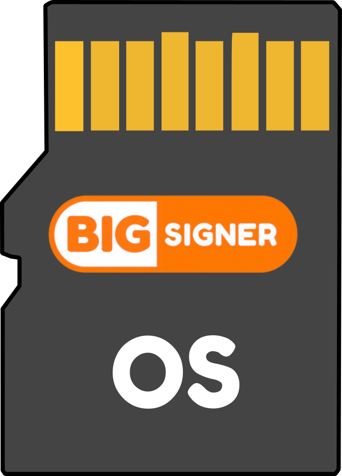

  

<h1 align="center">BigSigner OS</h1>

  

* [Overview](#overview)
* [HDMI touchscreen demo](docs/hdmi_touch_demo.md)
* [Building](docs/building.md)
* [Building (without Docker)](docs/without_docker.md)
* [BigSigner OS structure](docs/structure.md)
* [Dev workflow](docs/dev_workflow.md)
* [Customizing Buildroot](docs/customize_buildroot.md)

 

JUMP STRAIGHT TO: [🔥🔥🔥🛠 HDMI touchscreen demo 🛠🔥🔥🔥](docs/hdmi_touch_demo.md) — a hardware testrun before the [full BigSigner build](docs/building.md).

 

---

# Overview

A custom linux based operating system built to manage software running on an airgapped Bitcoin signing device. BigSigner is both the project name and [application](https://github.com/BigSigner/bigsigner/) running on airgapped hardware. This custom operating system, like all operating systems, manages the hardware resources and provides them to the application code. It's currently designed to run on common Raspberry Pi hardware with [accessories](https://github.com/BigSigner/bigsigner/#shopping-list). The goal of BigSigner OS is to provide an easy, fast, and secure way to build a microSD card image to securely run [BigSigner](https://github.com/BigSigner/bigsigner) code.

BigSigner OS is a fork of [SeedSigner OS](https://github.com/SeedSigner/seedsigner-os). The main difference is the display: BigSigner uses a larger 480×800 touchscreen over HDMI. The [HDMI touchscreen demo](docs/hdmi_touch_demo.md) is a hardware testrun of that panel before building the full BigSigner application.

## ⚙️ Under the Hood

BigSigner OS is built using [Buildroot](https://www.buildroot.org). Buildroot is a simple, efficient and easy-to-use tool to generate embedded Linux systems through cross-compilation. BigSigner OS does not fork Buildroot, but uses Buildroot with custom configurations to build microSD card images tailor made for running BigSigner.

## 🛂 Security

BigSigner OS is built to reduce the attack surface area and enable additional application functionality. The OS is an order of magnitude smaller in size than Raspberry Pi OS (which is what typically is used to run software on a Pi device). Here are a list of some security and functional advantages of using BigSigner OS.

- Boots 100% from RAM. This means, once you see the BigSigner splash screen, you can remove the microSD card because no disk I/O is needed after boot!
- One FAT32 partition on the microSD card
- Removes these standard Raspberry Pi OS Kernel modules:
   - Networking and Bluetooth
   - SWAP
   - I2C
   - Serial
   - USB
   - Pulse-Width Modulation (PWM)
- HDMI support for a 480×800 touch display
- NO Serial connection TTL support
- NO Software supporting any wireless or networking chips
- A single read only zImage file on the boot partition containing the entire Linux kernel and filesystem
